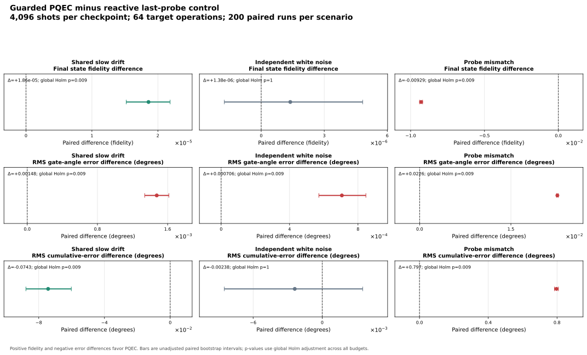
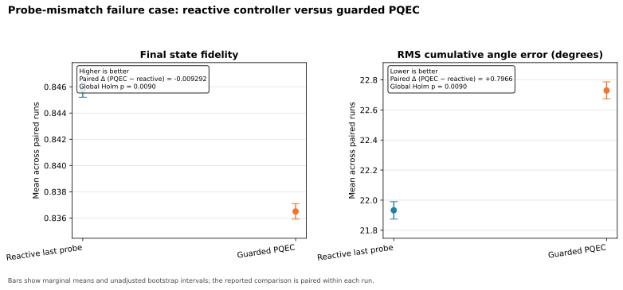
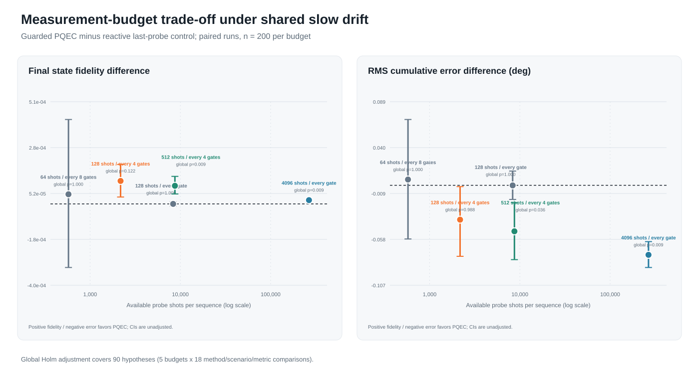

# Predictive Quantum Error Compensation (PQEC)

**Status: simulation-validated prototype; not hardware-validated quantum error correction.**

PQEC v0.2 tests predictive compensation of coherent single-qubit pulse-angle drift. A separately prepared auxiliary probe qubit supplies measurements; a classical controller uses their history to adjust the next target operation. The controller does not measure the target qubit's state. Experiment results in this repository come from the project's own simulator; publications listed under Related Work provide context and are not used as input data.

The current scope is deliberately narrow: repeated single-qubit Rx gates, a shared-drift hypothesis, finite-shot probe readout, and a separate probe-mismatch stress case. There is no encoded qubit, entangled probe pair, or hardware experiment.

## Main findings

At the full budget (4096 probe shots per checkpoint, every target cycle), the guarded predictor was compared with the reactive last-probe controller using 200 paired runs per condition. Positive fidelity differences and negative cumulative-error differences favor PQEC.

| Scenario | Final fidelity difference (95% paired CI) | Global Holm p | RMS cumulative-error difference (95% paired CI) | Global Holm p |
| --- | ---: | ---: | ---: | ---: |
| Shared slow drift | +1.858e-5 [1.520e-5, 2.186e-5] | 0.0090 | −0.0743 deg [−0.0878, −0.0602] | 0.0090 |
| Independent white noise | +1.384e-6 [−1.755e-6, 4.831e-6] | 1.0000 | −0.0024 deg [−0.0085, +0.0035] | 1.0000 |
| Probe mismatch | −0.009292 [−0.009397, −0.009190] | 0.0090 | +0.7966 deg [+0.7849, +0.8080] | 0.0090 |

The multiple-testing correction in this table covers 90 hypotheses across the five tested budgets. The bootstrap intervals are ordinary, unadjusted 95% intervals. Full parameter definitions and metric formulas are in [the mathematical model](docs/mathematical_model.md).

Gate-level results show a small but consistent trade-off: guarded PQEC has slightly lower mean gate fidelity and higher RMS gate-angle error than the reactive controller in all three scenarios.

| Scenario | Mean gate fidelity (reactive → guarded) | RMS gate-error difference (95% paired CI) | Global Holm p | Guarded prediction MAE |
| --- | ---: | ---: | ---: | ---: |
| Shared slow drift | 0.999999736 → 0.999999725 | +0.001476° [+0.001338°, +0.001614°] | 0.0090 | 0.0586° |
| Independent white noise | 0.999995662 → 0.999995641 | +0.000706° [+0.000571°, +0.000846°] | 0.0090 | 0.2338° |
| Probe mismatch | 0.999966865 → 0.999964981 | +0.022642° [+0.022500°, +0.022787°] | 0.0090 | 0.7456° |

Prediction MAE compares each forecast with the simulator's hidden upcoming target-qubit error; it is a simulation-only diagnostic. It is not a measurement available to the controller or a hardware-reported calibration score.

Under shared slow drift, both the final-fidelity gain and cumulative-error reduction had the same direction in each of the two seed blocks; the small per-gate error increase also repeated in both blocks.

## PQEC versus the reactive controller



## Explicit failure case: probe mismatch

The probe is modeled with a 0.20 deg offset and 0.03 deg/cycle drift; the target qubit has 0.01 deg/cycle drift. In this case guarded PQEC is significantly worse than the reactive controller. This failure is part of the result and is not hidden in an aggregate score.



## Measurement-budget results

Among reduced-budget settings, only the 512-shots-every-4-cycles setting retained a statistically supported gain under shared slow drift after the global correction across all five budgets.

| Shots/checkpoint, interval | Probe shots per sequence | Reduction from full budget | Final fidelity difference (95% CI) | Global p | Cumulative-error difference (95% CI) | Global p |
| --- | ---: | ---: | ---: | ---: | ---: | ---: |
| 4096, every cycle | 266240 | 1.0x | +1.858e-5 [1.520e-5, 2.186e-5] | 0.0090 | −0.0743 deg [−0.0878, −0.0602] | 0.0090 |
| 512, every 4 cycles | 8704 | 30.6x | +8.971e-5 [+4.926e-5, 1.363e-4] | 0.0090 | −0.0491 deg [−0.0794, −0.0186] | 0.0357 |
| 128, every cycle | 8320 | 32.0x | −6.943e-8 [−1.056e-5, 1.037e-5] | 1.0000 | −0.0001 deg [−0.0151, +0.0152] | 1.0000 |
| 128, every 4 cycles | 2176 | 122.4x | +1.136e-4 [+3.409e-5, 1.953e-4] | 0.1220 | −0.0367 deg [−0.0759, −0.0014] | 0.9881 |
| 64, every 8 cycles | 576 | 462.2x | +4.773e-5 [−3.150e-4, 4.181e-4] | 1.0000 | +0.0062 deg [−0.0573, +0.0703] | 1.0000 |



The 128-shots-every-4-cycles result is a preliminary positive signal, but it does not survive the global correction across budgets. Cross-budget comparisons are descriptive; the inferential tests are paired within each budget.

At the full budget, the active probe path uses 266,240 shots and 3,461,120 modeled probe rotations per 64-gate sequence. The simulator's Python controller timing is software overhead on the run host, not a hardware feedback-latency measurement.

## Architecture and model

The experiment uses a separate auxiliary probe qubit prepared in |+y>. It receives m repeated Rx(90 deg + delta) pulses and is measured along Y by applying S-dagger and H before Z-basis readout. For m = 4k + 1:

- P(0) = (1 − sin(m delta)) / 2
- estimated delta = −arcsin(2 p0 − 1) / m, after the configured readout correction

The predictor returns a corrected command angle before the next target operation. The simulator checks the Y-basis probability against a direct Pauli-Y expectation and the analytic expression; the largest observed discrepancy was 6.7e-16.

The guarded predictor is the primary PQEC variant. It estimates a rolling linear slope, suppresses trends that are weak relative to the fit residuals, and anchors the forecast to the latest probe reading. When the trend is not supported, it falls back to the last-probe correction. This threshold is a model heuristic, not a calibrated hardware confidence bound.

See [architecture](docs/architecture.md) and [the mathematical model](docs/mathematical_model.md) for details.

## Related Work

These publications provide context for spectator-qubit sensing, drift tracking, and adaptive calibration. They do not validate this repository's results, and this project does not claim to be the first or best method in these areas.

- **Spectator-qubit sensing:** Majumder, de Castro, and Brown, [“Real-time calibration with spectator qubits”](https://www.nature.com/articles/s41534-020-0251-y), *npj Quantum Information* 6, 19 (2020). They study periodically measured spectator qubits as probes of changing control and environmental parameters, with usefulness depending on correlation between spectator and data-qubit errors. PQEC uses a similar auxiliary-probe premise in a much narrower one-qubit simulation, and its mismatch case tests that premise directly.
- **Drift characterization:** Proctor et al., [“Detecting and tracking drift in quantum information processors”](https://www.nature.com/articles/s41467-020-19074-4), *Nature Communications* 11, 5396 (2020). They develop spectral analysis for time-dependent processor errors and demonstrate drift localization and control using characterization time series. PQEC instead estimates a scalar Rx-angle error from a separate probe and forecasts the next target operation.
- **Adaptive calibration and feedback:** Berritta et al., [“Efficient Qubit Calibration by Binary-Search Hamiltonian Tracking”](https://journals.aps.org/prxquantum/abstract/10.1103/77qg-p68k), *PRX Quantum* 6, 030335 (2025). They experimentally implement adaptive Bayesian qubit-frequency tracking with real-time FPGA feedback. PQEC uses a simpler guarded linear predictor in simulation and has no hardware feedback implementation.

PQEC's contribution here is an openly reproducible test configuration and comparison of a one-step trend-guarded estimator against a reactive probe baseline, including independent-noise and probe-mismatch cases. This is a project description, not a novelty claim.

## Reproduce the project

From the repository root, with Python 3.10 or later. The archived v0.2 results use the built-in analytic state-vector backend, which requires no third-party package:

```powershell
python -m venv .venv
.\.venv\Scripts\Activate.ps1

python pqec_single_qubit.py --config configs/full_run_v02.json
python pqec_budget_sweep.py --config configs/budget_sweep_v02.json
python plot_results.py

python -m unittest discover -s tests -v
```

Qiskit is optional for the one-qubit state simulation. To use the Qiskit `Statevector` backend instead, install it with `python -m pip install -r requirements.txt` before running the scripts. The archived v0.2 CSVs were generated with the analytic fallback. The saved v0.1 Qiskit run is retained under results/pqec_v01_qiskit_*.csv; common summary metrics matched the analytic implementation exactly.

The experiment configurations, seed schedule, CSV inventory, and reproduction details are documented in [reproducibility](docs/reproducibility.md). The main data files are:

- results/pqec_single_qubit_runs.csv — every method and paired trial for the full budget
- results/pqec_budget_sweep_summary.csv — five budgets, scenario summaries, and resource counts
- results/pqec_budget_sweep_paired_stats.csv — paired effects, bootstrap intervals, per-budget and global Holm-adjusted p-values
- results/experiment_seed_manifest.csv — trajectory, probe, and randomized-compiling seeds for each scenario/trial
- results/statistical_seed_manifest.csv — bootstrap and paired-permutation seeds for every scenario/metric/controller test
- results/budget_*_runs.csv — individual rows for each budget configuration

## Limitations

This is a single-qubit simulation of Rx angle errors. It excludes decoherence, leakage, crosstalk, spatially varying device noise, feedback latency, and output-state measurement cost. Target-state fidelity is computed exactly from the simulator state; it is not estimated from hardware readout shots.

The probe-mismatch result shows the central transfer assumption: the probe must track the target qubit’s control error. A single probe cannot diagnose its own mismatch from its measurement history alone. Independent random noise also receives no universal predictive benefit. The randomized-compiling entry is only a simplified sign-flip baseline, not a full circuit-level implementation.

Accordingly, these results support a reproducible simulation prototype for coherent-drift compensation. They do not establish hardware performance or a new fault-tolerant quantum error-correction technology. See [limitations and failure analysis](docs/limitations.md).
