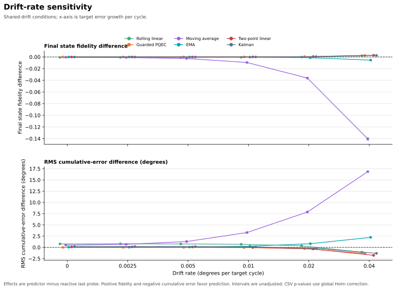
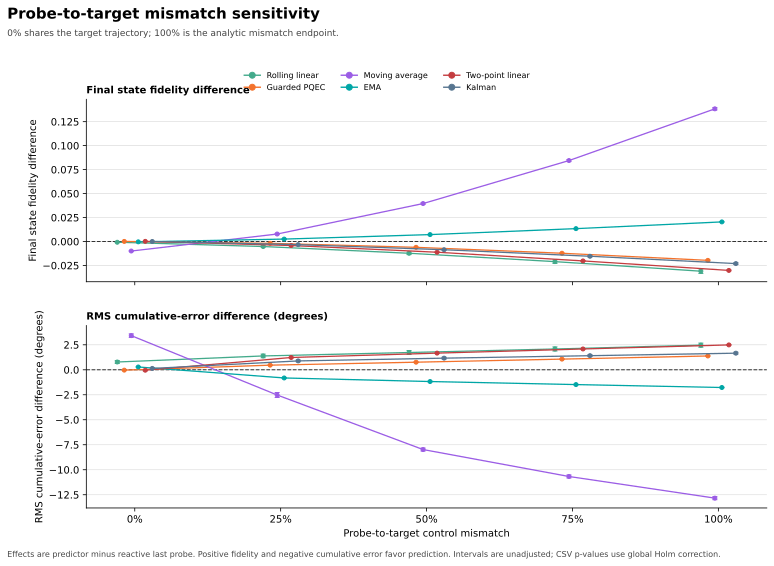
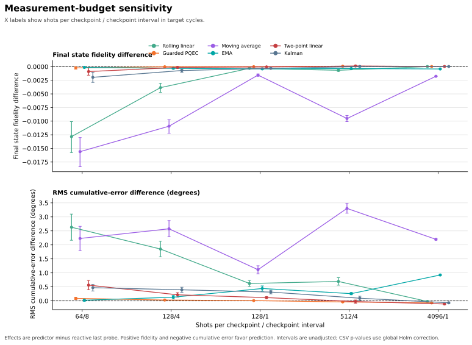
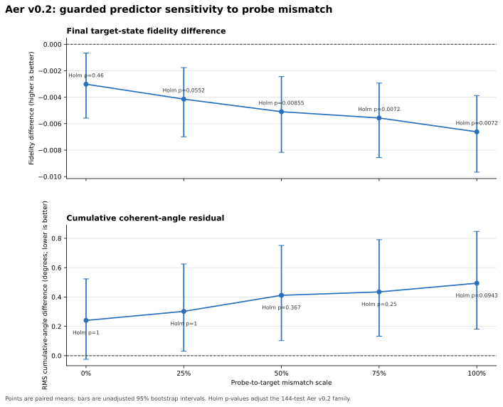
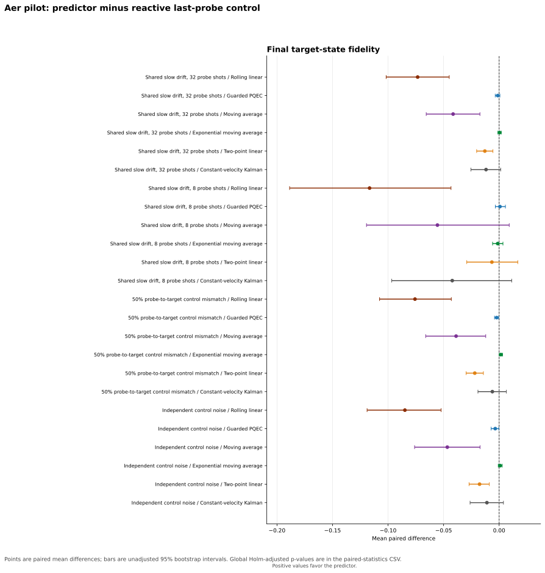
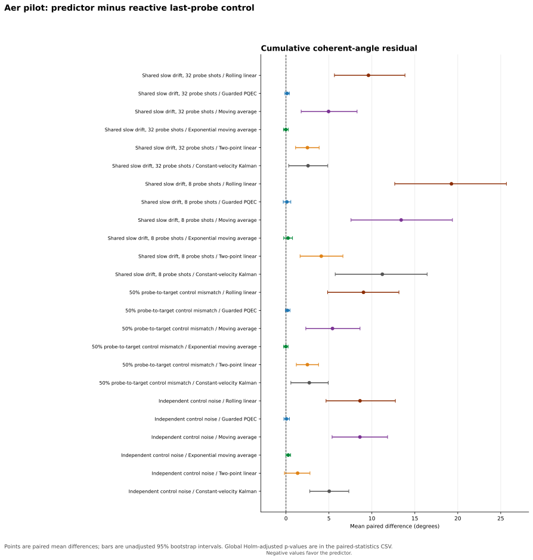

# Predictive Quantum Error Compensation (PQEC)

**Status: simulation-validated prototype; not hardware-validated quantum error correction.**

This repository contains the analytic v0.2/v0.3 single-qubit studies and separate Qiskit Aer noise-model studies (Aer v0.1/v0.2). A separately prepared auxiliary probe qubit supplies measurements; a classical controller uses their history to adjust the next target operation. The controller does not measure the target qubit's state. The results were generated from the project's own configurations and simulator runs; publications listed under Related Work provide context and are not used as input data.

The scope is deliberately narrow: repeated single-qubit Rx gates, finite-shot probe readout, and explicit shared-drift, independent-noise, and probe-mismatch cases. There is no encoded qubit, entangled probe pair, or hardware experiment.

## Main findings

At the full budget (4096 probe shots per checkpoint, every target cycle), the guarded predictor was compared with the reactive last-probe controller using 200 paired runs per condition. Positive fidelity differences and negative cumulative-error differences favor PQEC.

| Scenario | Final fidelity difference (95% paired CI) | Global Holm p | RMS cumulative-error difference (95% paired CI) | Global Holm p |
| --- | ---: | ---: | ---: | ---: |
| Shared slow drift | +1.858e-5 [1.520e-5, 2.186e-5] | 0.0090 | −0.0743 deg [−0.0878, −0.0602] | 0.0090 |
| Independent white noise | +1.384e-6 [−1.755e-6, 4.831e-6] | 1.0000 | −0.0024 deg [−0.0085, +0.0035] | 1.0000 |
| Probe mismatch | −0.009292 [−0.009397, −0.009190] | 0.0090 | +0.7966 deg [+0.7849, +0.8080] | 0.0090 |

The multiple-testing correction in this table covers 90 hypotheses across the five tested budgets. The bootstrap intervals are ordinary, unadjusted 95% intervals. Full parameter definitions and metric formulas are in [the mathematical model](docs/mathematical_model.md).

Gate-level results show a small but consistent trade-off: guarded PQEC has slightly lower mean gate fidelity and higher RMS gate-angle error than the reactive controller in all three scenarios.

| Scenario | Mean gate fidelity (reactive → guarded) | RMS gate-error difference (95% paired CI) | Global Holm p | Guarded prediction MAE |
| --- | ---: | ---: | ---: | ---: |
| Shared slow drift | 0.999999736 → 0.999999725 | +0.001476° [+0.001338°, +0.001614°] | 0.0090 | 0.0586° |
| Independent white noise | 0.999995662 → 0.999995641 | +0.000706° [+0.000571°, +0.000846°] | 0.0090 | 0.2338° |
| Probe mismatch | 0.999966865 → 0.999964981 | +0.022642° [+0.022500°, +0.022787°] | 0.0090 | 0.7456° |

Prediction MAE compares each forecast with the simulator's hidden upcoming target-qubit error; it is a simulation-only diagnostic. It is not a measurement available to the controller or a hardware-reported calibration score.

Under shared slow drift, both the final-fidelity gain and cumulative-error reduction had the same direction in each of the two seed blocks; the small per-gate error increase also repeated in both blocks.

## PQEC versus the reactive controller


## Explicit failure case: probe mismatch

The probe is modeled with a 0.20 deg offset and 0.03 deg/cycle drift; the target qubit has 0.01 deg/cycle drift. In this case guarded PQEC is significantly worse than the reactive controller. This failure is part of the result and is not hidden in an aggregate score.


## Measurement-budget results

Among reduced-budget settings, only the 512-shots-every-4-cycles setting retained a statistically supported gain under shared slow drift after the global correction across all five budgets.

| Shots/checkpoint, interval | Probe shots per sequence | Reduction from full budget | Final fidelity difference (95% CI) | Global p | Cumulative-error difference (95% CI) | Global p |
| --- | ---: | ---: | ---: | ---: | ---: | ---: |
| 4096, every cycle | 266240 | 1.0x | +1.858e-5 [1.520e-5, 2.186e-5] | 0.0090 | −0.0743 deg [−0.0878, −0.0602] | 0.0090 |
| 512, every 4 cycles | 8704 | 30.6x | +8.971e-5 [+4.926e-5, 1.363e-4] | 0.0090 | −0.0491 deg [−0.0794, −0.0186] | 0.0357 |
| 128, every cycle | 8320 | 32.0x | −6.943e-8 [−1.056e-5, 1.037e-5] | 1.0000 | −0.0001 deg [−0.0151, +0.0152] | 1.0000 |
| 128, every 4 cycles | 2176 | 122.4x | +1.136e-4 [+3.409e-5, 1.953e-4] | 0.1220 | −0.0367 deg [−0.0759, −0.0014] | 0.9881 |
| 64, every 8 cycles | 576 | 462.2x | +4.773e-5 [−3.150e-4, 4.181e-4] | 1.0000 | +0.0062 deg [−0.0573, +0.0703] | 1.0000 |


The 128-shots-every-4-cycles result is a preliminary positive signal, but it does not survive the global correction across budgets. Cross-budget comparisons are descriptive; the inferential tests are paired within each budget.

At the full budget, the active probe path uses 266,240 shots and 3,461,120 modeled probe rotations per 64-gate sequence. The simulator's Python controller timing is software overhead on the run host, not a hardware feedback-latency measurement.

## Expanded robustness study (v0.3)

The new one-factor-at-a-time sweep covers 35 conditions and 500 paired trials per condition (100 trials in each of five new seed blocks, IDs 2–6). It varies drift speed, initial error, probe-to-target control mismatch, probe-local noise, calibrated readout noise, independent white noise, and probe-shot/checkpoint budgets. Six predictors are compared with the reactive last-probe method. Global Holm correction covers all 630 predictor/condition/metric hypotheses; the full design and limitations are in [the v0.3 robustness report](docs/robustness_v03.md).

In the canonical shared-drift condition (2° initial error, 0.01°/cycle drift, 512 probe shots every 4 cycles), guarded PQEC improved final state fidelity by `+7.764e-5` (95% paired CI `[+5.142e-5, +1.046e-4]`, global Holm `p=0.0126`) and reduced RMS cumulative error by `−0.0374°` (CI `[−0.0566°, −0.0183°]`, `p=0.0262`). Both effects had the same direction in all five seed blocks. RMS gate-angle error increased slightly by `+0.00363°`, so the gain is sequence-level and does not improve every metric.

The stronger baseline comparison is mixed: a two-point forecast had a larger final-fidelity gain in this condition, but its gate-angle error was higher and there was no adjusted evidence of lower cumulative error. The rolling linear, moving-average, EMA, and Kalman baselines did not improve both sequence-level metrics together. For example, EMA and Kalman lowered per-gate RMS error while worsening cumulative error or failing to show a final-fidelity gain. The report and CSV show every paired effect and interval; no single predictor dominates every metric and condition.



The graded transfer test holds readout aligned while increasing only control mismatch between the auxiliary probe and target. At 0% mismatch, guarded PQEC improves final fidelity; at 25% mismatch, the final-fidelity difference is already `−0.001911` and the RMS cumulative-error difference is `+0.462°` (both globally Holm-supported). Degradation grows through 50%, 75%, and 100%. A separate joint-mismatch point preserves the archived 2%-actual/1%-assumed readout stress case.



For the measurement-budget sweep, the 512-shots-every-4-cycles and 4,096-shots-every-cycle settings retain guarded-PQEC gains after correction; the 128-shot settings show no supported sequence-level gain, and 64 shots every 8 cycles significantly worsens cumulative error in this model.



The sweep confirms that the measured gain depends on sufficiently shared, slowly drifting control error. Independent white noise did not produce a supported final-fidelity or cumulative-error improvement for guarded PQEC. At 10% calibrated probe readout error, the apparent final-fidelity gain also does not survive the global correction.

## Qiskit Aer noise-model study (v0.2 expanded mismatch sweep)

The expanded Aer study adds 200 paired trials per condition across eight independent seed blocks (IDs 12–19) and a graded 0–100% probe-to-target control-mismatch sweep. It keeps the v0.1 stylized T1/T2, depolarizing, readout, finite-shot probe, and feedback-idle model. Eight conditions × six predictors × three metrics yield 144 paired tests; the saved output has 12,800 per-method rows and 1,600 trajectory/seed records.

The table below reports guarded PQEC minus reactive last-probe control. The intervals are unadjusted paired 95% bootstrap intervals, and p-values receive global Holm correction across all 144 comparisons.

| Condition | Final-fidelity difference (95% CI) | Holm p | Cumulative-angle difference (95% CI) | Holm p |
| --- | ---: | ---: | ---: | ---: |
| Shared drift, 32 shots | −0.002031 [−0.004199, −0.000155] | 1.0000 | +0.062° [−0.142°, +0.291°] | 1.0000 |
| Shared drift, 8 shots | −0.002093 [−0.006592, +0.002034] | 1.0000 | +0.223° [−0.087°, +0.556°] | 1.0000 |
| 0% control mismatch | −0.003017 [−0.005577, −0.000660] | 0.4603 | +0.241° [−0.025°, +0.524°] | 1.0000 |
| 25% control mismatch | −0.004144 [−0.006989, −0.001761] | 0.0552 | +0.302° [+0.031°, +0.625°] | 1.0000 |
| 50% control mismatch | −0.005097 [−0.008166, −0.002442] | 0.0085 | +0.412° [+0.103°, +0.752°] | 0.3672 |
| 75% control mismatch | −0.005570 [−0.008560, −0.002931] | 0.0072 | +0.435° [+0.133°, +0.791°] | 0.2497 |
| 100% control mismatch | −0.006615 [−0.009666, −0.003871] | 0.0072 | +0.494° [+0.181°, +0.847°] | 0.0943 |
| Independent white noise | −0.000058 [−0.001672, +0.001512] | 1.0000 | −0.112° [−0.308°, +0.079°] | 1.0000 |

Guarded PQEC shows no corrected sequence-level advantage over reactive control in any condition. At 50–100% mismatch, the final-fidelity difference is significantly negative after correction; the 25% result does not pass the global threshold. Its RMS per-operation coherent-angle residual is higher in all eight conditions (global Holm p = 0.0072 in each). The full 144-comparison dataset also shows that simple predictors behave differently by metric: exponential moving average gains final fidelity at higher mismatch levels, but it does not establish a corrected cumulative-error gain.



The full [Aer v0.2 report](docs/aer_noise_v02.md) documents the model and all statistics. Full comparison figures are available for [final fidelity](figures/aer_noise_v02_final_fidelity.svg) and [cumulative angle error](figures/aer_noise_v02_cumulative_error.svg). These are simulation results, not a hardware claim.

## Qiskit Aer noise-model pilot (v0.1, archived)

The separate Aer pilot adds heterogeneous target/probe T1 and T2, per-gate depolarization, asymmetric probe readout error, finite-shot probe measurements, and explicit target idling during serial probe acquisition and controller latency. Its stylized noise values are frozen in [the Aer configuration](configs/aer_noise_v01.json); they are not copied from a particular device.

Four conditions use 100 paired trials each across five seed blocks. Reactive last-probe control is compared with guarded PQEC and five additional causal predictors. The target's final density matrix is scored directly inside Aer, while the controller only receives probe measurement counts.

| Condition | Guarded-PQEC final-fidelity difference (95% CI) | Global Holm p | Cumulative-angle difference (95% CI) | Global Holm p |
| --- | ---: | ---: | ---: | ---: |
| Shared drift, 32 shots | −0.001308 [−0.003515, +0.000701] | 1.0000 | +0.132° [−0.130°, +0.396°] | 1.0000 |
| Shared drift, 8 shots | +0.000729 [−0.003414, +0.005677] | 1.0000 | +0.105° [−0.319°, +0.563°] | 1.0000 |
| 50% probe mismatch | −0.002188 [−0.004155, −0.000391] | 0.6709 | +0.181° [−0.069°, +0.466°] | 1.0000 |
| Independent white noise | −0.003505 [−0.007214, −0.000298] | 0.9570 | +0.057° [−0.244°, +0.401°] | 1.0000 |

No guarded-PQEC sequence-level gain survives the global correction across 72 tests. Its per-operation coherent-angle residual is higher than the reactive controller in all four conditions (global Holm p = 0.0036). This pilot therefore does not demonstrate an Aer-model advantage for PQEC; it shows that the gain from the simpler analytic model does not automatically carry over once shot noise, per-gate channels, probe/target differences, and feedback waiting time are included.

The 32-shot setting uses 236.8 μs of serial probe acquisition and models 221.2 μs of target idling per sequence. At 8 shots, these fall to 59.2 μs and 65.8 μs, respectively, but the probe estimate is noisier. See the [full Aer report](docs/aer_noise_v01.md) for the noise channels, inference method, exact parameter limits, and results.





## Architecture and model

The experiment uses a separate auxiliary probe qubit prepared in |+y>. It receives m repeated Rx(90 deg + delta) pulses and is measured along Y by applying S-dagger and H before Z-basis readout. For m = 4k + 1:

- P(0) = (1 − sin(m delta)) / 2
- estimated delta = −arcsin(2 p0 − 1) / m, after the configured readout correction

The predictor returns a corrected command angle before the next target operation. The simulator checks the Y-basis probability against a direct Pauli-Y expectation and the analytic expression; the largest observed discrepancy was 6.7e-16.

The guarded predictor is the primary PQEC variant. It estimates a rolling linear slope, suppresses trends that are weak relative to the fit residuals, and anchors the forecast to the latest probe reading. When the trend is not supported, it falls back to the last-probe correction. This threshold is a model heuristic, not a calibrated hardware confidence bound.

See [architecture](docs/architecture.md) and [the mathematical model](docs/mathematical_model.md) for details.

## Related Work

These publications provide context for spectator-qubit sensing, drift tracking, and adaptive calibration. They do not validate this repository's results, and this project does not claim to be the first or best method in these areas.

- **Spectator-qubit sensing:** Majumder, de Castro, and Brown, [“Real-time calibration with spectator qubits”](https://www.nature.com/articles/s41534-020-0251-y), *npj Quantum Information* 6, 19 (2020). They study periodically measured spectator qubits as probes of changing control and environmental parameters, with usefulness depending on correlation between spectator and data-qubit errors. PQEC uses a similar auxiliary-probe premise in a much narrower one-qubit simulation, and its mismatch case tests that premise directly.
- **Drift characterization:** Proctor et al., [“Detecting and tracking drift in quantum information processors”](https://www.nature.com/articles/s41467-020-19074-4), *Nature Communications* 11, 5396 (2020). They develop spectral analysis for time-dependent processor errors and demonstrate drift localization and control using characterization time series. PQEC instead estimates a scalar Rx-angle error from a separate probe and forecasts the next target operation.
- **Adaptive calibration and feedback:** Berritta et al., [“Efficient Qubit Calibration by Binary-Search Hamiltonian Tracking”](https://journals.aps.org/prxquantum/abstract/10.1103/77qg-p68k), *PRX Quantum* 6, 030335 (2025). They experimentally implement adaptive Bayesian qubit-frequency tracking with real-time FPGA feedback. PQEC uses a simpler guarded linear predictor in simulation and has no hardware feedback implementation.

PQEC's contribution here is an openly reproducible test configuration and comparison of a one-step trend-guarded estimator against a reactive probe baseline, including independent-noise and probe-mismatch cases. This is a project description, not a novelty claim.

## Reproduce the project

From the repository root, with Python 3.10 or later. The archived v0.2 results use the built-in analytic state-vector backend, which requires no third-party package:

```powershell
python -m venv .venv
.\.venv\Scripts\Activate.ps1

python pqec_single_qubit.py --config configs/full_run_v02.json
python pqec_budget_sweep.py --config configs/budget_sweep_v02.json
python -m pip install -r requirements-plotting.txt
python plot_results.py

python -m pip install -r requirements-robustness.txt
python pqec_robustness_sweep.py --config configs/robustness_v03.json
python plot_robustness.py

python -m unittest discover -s tests -v
```

Qiskit is optional for the analytic one-qubit state simulation. To use its Statevector backend, install requirements.txt. The plotting scripts use the pinned Matplotlib version in requirements-plotting.txt; requirements-robustness.txt also includes it for the v0.3 figures. The Aer noise-model studies have a separate pinned environment because they use a different NumPy version from the analytic v0.3 run; follow the reproduction commands in the [Aer v0.2 report](docs/aer_noise_v02.md). The archived v0.2 CSVs were generated with the analytic fallback.

The experiment configurations, seed schedule, CSV inventory, and reproduction details are documented in [reproducibility](docs/reproducibility.md). The main data files are:

- results/pqec_single_qubit_runs.csv — every method and paired trial for the full budget
- results/pqec_budget_sweep_summary.csv — five budgets, scenario summaries, and resource counts
- results/pqec_budget_sweep_paired_stats.csv — paired effects, bootstrap intervals, per-budget and global Holm-adjusted p-values
- results/experiment_seed_manifest.csv — trajectory, probe, and randomized-compiling seeds for each scenario/trial
- results/statistical_seed_manifest.csv — bootstrap and paired-permutation seeds for every scenario/metric/controller test
- results/budget_*_runs.csv — individual rows for each budget configuration
- results/robustness_v03/pqec_robustness_runs.csv — all 17,500 paired robustness trials and six forecasting methods plus the reactive baseline
- results/robustness_v03/pqec_robustness_paired_stats.csv — all 630 comparisons, confidence intervals, raw and Holm-adjusted p-values, and seed-block effects
- results/robustness_v03/pqec_robustness_seed_manifest.csv — per-condition trajectory and NumPy probe-sampling seeds
- results/robustness_v03/pqec_robustness_stats_seed_manifest.csv — bootstrap and sign-flip seeds for every condition
- results/aer_noise_v01/pqec_aer_runs.csv — all 3,200 Aer per-method trial rows, including probe records
- results/aer_noise_v01/pqec_aer_paired_stats.csv — 72 paired Aer comparisons and global Holm-adjusted p-values
- results/aer_noise_v01/pqec_aer_seed_manifest.csv — 400 Aer trajectory and simulator seed records
- results/aer_noise_v01/pqec_aer_config_snapshot.json — exact Aer pilot configuration used for the saved output
- results/aer_noise_v02/pqec_aer_runs.csv — all 12,800 per-method trial rows across eight conditions
- results/aer_noise_v02/pqec_aer_paired_stats.csv — all 144 paired Aer comparisons and global Holm-adjusted p-values
- results/aer_noise_v02/pqec_aer_seed_manifest.csv — 1,600 trajectory and simulator seed records from eight new seed blocks
- results/aer_noise_v02/pqec_aer_config_snapshot.json — exact expanded mismatch-sweep configuration

## Limitations

The v0.2/v0.3 studies use an analytic single-qubit model. The Aer v0.1/v0.2 studies add stylized T1/T2 relaxation, depolarizing gate channels, asymmetric probe readout, and modeled target waiting time; v0.2 expands the paired seed blocks and sweeps probe-target mismatch from 0% to 100%. These Aer parameters remain illustrative and omit leakage, crosstalk, correlated environmental noise, pulse shaping, calibration uncertainty, and several other device effects. Target-state fidelity in both simulation tracks is computed from simulator state; it is not estimated from hardware readout shots.

The probe-mismatch result shows the central transfer assumption: the probe must track the target qubit’s control error. A single probe cannot diagnose its own mismatch from its measurement history alone. Independent random noise also receives no universal predictive benefit. The randomized-compiling entry is only a simplified sign-flip baseline, not a full circuit-level implementation.

Accordingly, these results support a reproducible simulation prototype for coherent-drift compensation. The expanded Aer v0.2 study found no guarded-PQEC sequence-level gain over reactive control after global correction; its mismatch sweep instead shows worsening target-state fidelity as probe-target mismatch grows. Neither simulation track establishes hardware performance or a new fault-tolerant quantum error-correction technology. See [limitations and failure analysis](docs/limitations.md).
