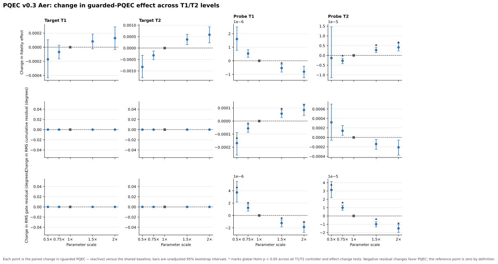
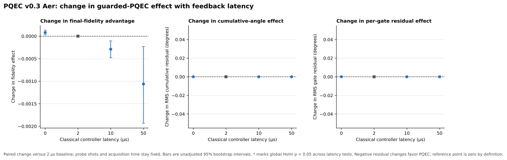

# PQEC v0.3 Aer Sensitivity Sweeps

## Scope

These two Qiskit Aer runs isolate the effects of relaxation/decoherence settings and feedback delay in the repository's stylized single-qubit noise model. They add no controller algorithms. They do not use parameters measured from a physical device and do not establish hardware performance.

Both sweeps use the Aer v0.2 model, 61 target rotations, shared slow coherent drift (1.2° initial offset and 0.025° per target cycle), 32 probe shots at each checkpoint, and a checkpoint interval of eight target cycles. Each condition has 200 paired trajectories in seed blocks 20–27 (25 trials per block), with the same derived target/probe trajectory seeds reused across levels. The reactive controller and all predictors in a trajectory receive the same finite-shot probe record.

The probe response curve is recalculated for each condition using that condition's configured probe channel. This preserves the existing optimistic assumption of exact, stationary probe calibration while isolating physical channel changes from a stale calibration curve.

## T1/T2 sweep

Target T1, target T2, probe T1, and probe T2 are varied separately. Each factor uses 0.5×, 0.75×, 1×, 1.5×, and 2× its reference value. A single shared reference condition gives 17 unique conditions total. All other configured values, including probe shots, checkpoint interval, latency, gate duration, and depolarizing probability, remain fixed. Every value satisfies the Aer constraint $T_2 \leq 2T_1$.

| Factor changed | Reference | Tested values |
| --- | ---: | --- |
| Target T1 | 500 µs | 250, 375, 500, 750, 1,000 µs |
| Target T2 | 300 µs | 150, 225, 300, 450, 600 µs |
| Probe T1 | 400 µs | 200, 300, 400, 600, 800 µs |
| Probe T2 | 250 µs | 125, 187.5, 250, 375, 500 µs |

The run contains 3,400 paired trajectories and 27,200 per-method rows. The primary table contains 306 predictor-versus-reactive tests. The sensitivity table contains 288 paired changes in that controller effect relative to the shared reference condition. A single Holm correction covers all 594 tests; 95% percentile bootstrap intervals are paired but are not multiplicity-adjusted. Each test uses 5,000 bootstrap resamples and 20,000 paired sign flips.

### Results

Across the 17 conditions, guarded PQEC's final-fidelity difference from reactive control ranges from −0.001732 to −0.000322. No condition has a corrected significant fidelity advantage for guarded PQEC. Its RMS per-gate angle residual is higher by 0.031602–0.031648° in every condition; all 17 tests remain significant under the combined correction. Its RMS cumulative-angle residual is lower by 0.107479–0.108008°, but none of those differences is significant after correction.

The reactive controller's mean final fidelity changes substantially when target relaxation is varied: it is 0.873292 at target T1 = 250 µs and 0.832023 at 1,000 µs; for target T2 it is 0.851173 at 150 µs and 0.845385 at 600 µs. Probe-only T1/T2 changes produce much smaller changes in target fidelity under the exact per-condition calibration assumption. These absolute values are simulator outputs, not a universal rule that shorter coherence times improve a processor. In this sequence, T1/T2 relaxation during target idle can damp some coherent rotation error; that sequence-specific explanation is an inference from the configured model.

Some paired effect-change tests for probe T1/T2 cross the corrected 0.05 threshold, but the corresponding changes are tiny: at most $4.1\times10^{-6}$ in fidelity, $3.2\times10^{-5}$° in RMS gate residual, and $1.7\times10^{-4}$° in RMS cumulative-angle residual. These should not be read as a practically useful PQEC gain.



## Feedback-latency sweep

The classical controller delay is 0, 2, 10, or 50 µs. Probe shots remain fixed at 32 per checkpoint, the interval remains eight target cycles, and T1/T2, drift, readout, and gate-noise parameters are unchanged. A probe shot takes 0.925 µs in the model, so acquisition remains 29.6 µs per checkpoint at every latency. The zero-latency condition therefore still includes probe acquisition and target idle evolution.

There are seven post-checkpoint waits per sequence. The total modeled target idle time for active probe controllers is 207.2, 221.2, 277.2, and 557.2 µs at the four latency settings. This is the probe-acquisition time plus the selected classical delay. The no-compensation reference does not acquire a probe and has no modeled wait, so it is not an equal-resource comparison.

The run contains 800 paired trajectories and 6,400 per-method rows. The primary analysis has 72 predictor-versus-reactive tests and the paired effect-change analysis has 54 contrasts against the 2 µs reference. One Holm correction covers all 126 tests; bootstrap intervals are paired and unadjusted.

| Controller delay | Target idle per sequence | Reactive final fidelity | Guarded final fidelity | Guarded − reactive | Holm p |
| ---: | ---: | ---: | ---: | ---: | ---: |
| 0 µs | 207.2 µs | 0.845514 | 0.844690 | −0.000823 | 1.0000 |
| 2 µs | 221.2 µs | 0.847721 | 0.846816 | −0.000905 | 1.0000 |
| 10 µs | 277.2 µs | 0.856108 | 0.854914 | −0.001194 | 1.0000 |
| 50 µs | 557.2 µs | 0.889274 | 0.887308 | −0.001966 | 0.5142 |

Guarded PQEC has no corrected final-fidelity advantage at any latency; its paired effect-change contrasts versus 2 µs are also nonsignificant. RMS per-gate error remains higher by 0.031617° at every level, while the approximately −0.107798° cumulative-angle difference is not significant.

The simulated reactive and guarded final fidelities rise as the modeled wait grows. This counterintuitive result is specific to this sequence and channel: an idle T1 relaxation toward $|0\rangle$ can partially damp accumulated coherent rotation error between eight-pulse blocks. That explanation is an inference, not a claim that longer feedback latency helps real devices. The simulation keeps the coherent error trajectory indexed by target-operation cycle; it does not accumulate additional control drift during the extra wall-clock wait. Thus this is an isolated sweep of the idle-channel effect of delay, not a complete model of stale feedback under time-varying hardware drift.



## Interpretation and limits

Neither sweep reveals a T1/T2 or latency regime in which guarded PQEC beats reactive last-probe control on final-state fidelity after correction. The per-gate error remains consistently worse, while the small cumulative-angle difference is not statistically supported. The probe-channel effect changes that pass correction are numerically negligible.

The study isolates one configured factor at a time. It does not test interactions between relaxation, drift, probe mismatch, measurement budget, and delay. T1/T2 and delay values are stylized; leakage, crosstalk, correlated noise, pulse shaping, calibration uncertainty, device-derived channels, and drift during wall-clock delay remain outside the model. The target density matrix is used only for offline scoring. These results strengthen the simulation sensitivity analysis, but do not constitute hardware validation or encoded-qubit error correction.

## Reproduction

Use the pinned Aer environment described in [reproducibility](reproducibility.md):

```powershell
python -m venv .venv-aer
.\.venv-aer\Scripts\Activate.ps1
python -m pip install -r requirements-aer.txt

python pqec_aer_sweep.py --config configs/aer_t1t2_sweep_v03.json
python pqec_aer_sweep.py --config configs/aer_feedback_latency_sweep_v03.json
python plot_aer_sensitivity_v03.py
python -m unittest discover -s tests -v
```

The complete CSVs, seed manifests, configuration snapshots, per-condition probe calibrations, and environment records are saved under `results/pqec_v03/aer_t1t2/` and `results/pqec_v03/aer_latency/`.
