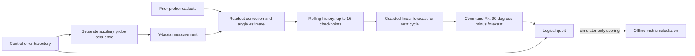

# PQEC Architecture

## Scope

PQEC is a simulation prototype for estimating coherent single-qubit pulse-angle drift from an auxiliary calibration qubit, then adjusting the next logical pulse. The controller receives probe readout history only. It never receives the logical qubit's state or the simulator's hidden error values.

The nominal shared-drift case assumes that the probe and logical qubit experience the same pulse-angle error trajectory. The independent-noise and probe-mismatch cases deliberately test that assumption.

## Data path

The dashed path is used only to calculate simulation metrics after the run. It is not available to the controller. The diagram represents the modeled common-drift path; the independent and mismatch conditions replace that shared relationship with separate error trajectories.

## Probe and estimator

At each checkpoint, the simulator prepares a separate probe in $|+y\rangle$, applies $m=13$ rotations $R_x(90^\circ+\delta_p)$, then measures along Y by applying $S^\dagger$, H, and computational-basis readout. Each checkpoint uses the configured number of shots. A startup checkpoint is taken before the logical sequence; later checkpoints follow the configured interval.

The readout counts are corrected using the configured symmetric readout-error estimate. The signed angle estimate is recovered from the Y-basis probability. Details and equations are in [the mathematical model](mathematical_model.md).

## Controllers

- **Reactive last probe:** for a logical pulse, subtract the newest probe estimate whose checkpoint precedes that pulse.
- **Predictive linear:** fit a line to up to the latest 16 probe estimates and extrapolate it to the next pulse.
- **Guarded PQEC:** fit the same rolling line, but suppress weak trends and shrink stronger slopes. The forecast is anchored to the latest measurement. When the trend is not supported, it falls back to the latest reading.

The guarded defaults are a trend threshold of 2, at least 4 readings before a trend is used, and a 16-checkpoint history. The threshold is a heuristic in this prototype; it is not a hardware-calibrated confidence test.

## Comparison methods

The simulator also reports an ideal reference, an oracle upper bound that knows the true upcoming error, no compensation, one-time static calibration, and a simplified randomized-compiling baseline. The oracle is not implementable from probe history. The randomized-compiling baseline randomizes the sign of an X-axis coherent error in the model; it does not implement circuit-level Pauli twirling, correction compilation, or Pauli-frame tracking.

Reactive and predictive methods use the same probe record within each paired run. This holds measurement noise and the modeled trajectory fixed while comparing controller rules.

